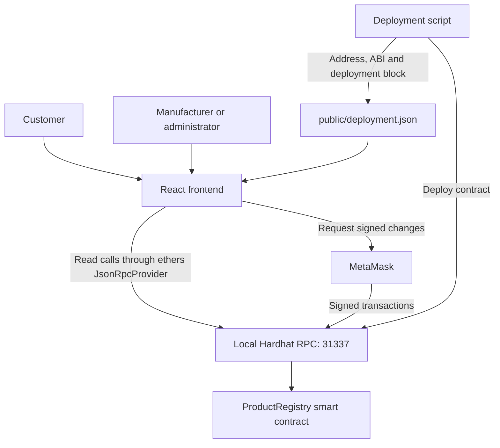

# How Origin Works

## 1. Overview and project-review explanation

Origin is a Blockchain-Based Product Authenticity Verification System built as a local demonstration. It solves the narrower, technically defensible problem of checking whether an authorized manufacturer registered a serial number and whether that registration is still active. A customer can inspect the issuer, product information, timestamp and transaction evidence without a wallet.

For a presentation: “The blockchain is an auditable registry of manufacturer claims. Our system prevents unauthorized registrations and duplicate serial IDs, and makes revocation visible. It does not independently authenticate a physical object.”

There is no application database and no local-storage imitation of blockchain data. Restarting Hardhat removes its in-memory blockchain. The frontend always uses contract calls to determine registration status.

## 2. Architecture



Vite serves the React app. `src/chain.ts` uses an ethers `JsonRpcProvider` for reads and `BrowserProvider` around MetaMask for writes. The deploy script writes a fresh address and ABI, so no deployment address is embedded in source code. The frontend also checks deployed bytecode and the deployment block hash to detect a chain restart or mismatched configuration. A wallet using another chain with the same numeric chain ID is checked against that deployment block too.

The one-command runner binds RPC and Vite to loopback. It refuses to take over an occupied port, starts Hardhat, polls `eth_chainId`, deploys, then starts Vite. Ctrl+C terminates its child processes. This lifecycle was tested on Linux; its Windows `taskkill` cleanup branch requires local Windows confirmation.

## 3. Registration flow

1. The deployer is `administrator`; nobody is implicitly a manufacturer.
2. The administrator calls `setManufacturer(address, true)`. `ManufacturerAuthorization(address,bool)` records the permission change.
3. An authorized wallet enters six fields in Workspace: product ID, name, brand, category, batch and manufacturer name.
4. `validateMetadata()` normalizes and validates the fields. `metadataHash()` computes the commitment described below.
5. `walletContract()` checks the deployment and wallet network, then creates a contract connected to the MetaMask signer.
6. `registerProduct(id,name,brand,category,batch,manufacturerName,metadataHash)` enforces access, input validity and uniqueness on-chain.
7. The contract stores the fields, `msg.sender`, `block.timestamp`, the hash and `revoked=false`. It appends the ID to `ids` and emits `ProductRegistered(idHash,productId,manufacturer,metadataHash)`.
8. The UI displays “confirm”, then “submitted”, and only displays success after `tx.wait()` yields a successful receipt. It shows transaction hash and block, refreshes totals, and generates a downloadable QR code and verification URL.

IDs are individual serials, not just a product model shared by many physical units. A duplicate remains forbidden even if the original record is revoked. There is no edit/delete/restore function.

## 4. Verification and QR flow

Manual entry and `/verify/:id` both normalize the ID and read the same local registry. A fresh browser load at a verification route works through Vite's SPA fallback; an HTTP deep-link response was verified by the integration test. A separately hosted static production build must rewrite unknown paths to `index.html`.

| Condition | UI result |
| --- | --- |
| `exists(id) == false` | Not found / unregistered; never considered registered or genuine |
| `exists(id) == true`, `revoked == false` | Registered and active |
| `exists(id) == true`, `revoked == true` | Revoked — not currently valid |
| Missing RPC, invalid config or read error | Error; no fabricated product result |

For an existing record, `getProduct()` returns the stored struct. The page shows issuer address, timestamp, metadata hash and contract address. It queries the `ProductRegistered` event, filtering by `keccak256(UTF8(id))`, to show the registration transaction and block. It recomputes the metadata hash from the returned fields and explicitly warns if the stored hash does not match.

The customer should use **Refresh status** to reread an open record after another user changes it; there is no background event subscription. Dashboard records are fetched on mounting and after this page's own confirmed writes. They are ordered by registration order, newest first, with 12-item load-more pagination. This is a product list, not a full authorization/revocation event browser.

QR generation uses `qrcode` with medium error correction. The QR encodes the current origin plus `/verify/<canonical ID>`. The app provides copy and download controls. Camera scanning is intentionally not implemented; a QR can be opened with an external reader where the host is reachable, and manual entry always works. In the supplied loopback-only setup, a phone cannot use the computer's localhost URL.

## 5. Permissions

| Operation | Administrator | Authorized manufacturer | Other wallet / no wallet |
| --- | --- | --- | --- |
| Read records | Yes | Yes | Yes |
| Authorize/remove manufacturer | Yes | No | No |
| Register product | Only if separately authorized | Yes | No |
| Revoke any product | Yes | No | No |
| Revoke own product | Yes | Yes, while still authorized | No |

Removing authorization blocks future registration and manufacturer revocation; it does not retroactively revoke products. The administrator can revoke those products if needed. Another authorized manufacturer cannot revoke someone else's record. The UI hides or disables unavailable operations, but the contract is the actual security boundary. Account/network changes reload the page so stale roles and transaction state are not reused.

## 6. Exact metadata normalization and hashing

Implementation: `src/metadata.mjs`, shared by frontend and metadata tests.

1. Convert each supplied field to a JavaScript string.
2. Apply Unicode NFC normalization.
3. Trim leading/trailing JavaScript whitespace and replace every run matched by `/\s+/gu` with one ASCII space.
4. Uppercase **only the product ID** with JavaScript `toUpperCase()`.
5. Validate the normalized ID against `^[A-Z0-9_-]{1,64}$`. Each other field must contain 1–160 UTF-8 bytes.
6. Construct this exact ordered array: `["product-registry:v1", productId, name, brand, category, batch, manufacturerName]`.
7. Serialize using `JSON.stringify` without added spaces or newline.
8. Encode using ethers `toUtf8Bytes`; compute ethers `keccak256` (Ethereum Keccak-256, **not NIST SHA3-256**).

Example serialized bytes represent this exact string:

```json
["product-registry:v1","ORIGIN-001","Field Watch","Origin","Watches","B-1","Origin Workshop"]
```

Expected hash, calculated using the delivered implementation:

```text
0x916274d1307a973939f89fc3ccb5d35b0d1fe683ef2c350406ded4dbdac2fcf9
```

Reproduce from the project root:

```powershell
node --input-type=module -e "import {metadataHash} from './src/metadata.mjs'; console.log(metadataHash({productId:'ORIGIN-001',name:'Field Watch',brand:'Origin',category:'Watches',batch:'B-1',manufacturerName:'Origin Workshop'}));"
```

The wallet address, timestamp and revoked status are not hash inputs: they are contract-managed state, and revocation must not change the metadata commitment. The contract validates IDs, text byte lengths/nonblank ASCII content, and a nonzero hash; it does not implement Unicode normalization or recalculate this JSON-based hash. A custom client can submit an inconsistent nonzero hash, which the verification page detects. The hash is a reproducible integrity check, not proof that the manufacturer's description is truthful or that a QR is physically bound to a product. All fields are public, so the hash also provides no confidentiality.

## 7. Files and responsibilities

| Path | Purpose |
| --- | --- |
| `contracts/ProductRegistry.sol` | Storage, permissions, registration, revocation and read functions |
| `hardhat.config.cjs` | Local chain 31337, pinned npm Solidity compiler, optimizer/IR configuration |
| `scripts/deploy.cjs` | Deploy and write runtime address, ABI and deployment-block identity |
| `scripts/demo.cjs` | Cross-platform Node startup and child-process shutdown |
| `scripts/smoke.cjs` | Real-chain checks against an already running demo |
| `scripts/integration.cjs` | Start a fresh demo, run checks, stop and verify closed ports |
| `scripts/browser-test.cjs` | Playwright UI checks with a test-only real-RPC wallet adapter |
| `test/registry.cjs` | 14 contract test cases |
| `test/metadata.test.mjs` | Three normalization/hash/validation cases |
| `src/main.tsx` | Routes, dashboard, workspace, forms, verification, transactions and QR UI |
| `src/chain.ts` | Read provider, deployment validation, wallet/network handling, errors |
| `src/metadata.mjs` / `metadata.d.mts` | Shared canonicalization/hash logic and TypeScript declarations |
| `src/style.css` | Responsive layout, forms, states and Tailwind layers |
| `public/deployment.json` | Generated at deployment; intentionally excluded from delivered source archive |
| `index.html`, `vite.config.mts` | App entry, React build and dependency chunks |
| `tailwind.config.cjs`, `postcss.config.cjs`, `tsconfig.json` | Styling and strict TypeScript checks |
| `package.json`, `package-lock.json` | Pinned installation and scripts |
| `README.md`, `HOW_IT_WORKS.md`, `TESTING.md` | Startup, implementation explanation and real validation report |

Hardhat generates `artifacts/` and `cache/`; Vite generates `dist/`. These and `node_modules/` are excluded from the archive. `npm ci` and deployment recreate them. No environment file or secret API key is needed.

## 8. Windows setup, deployment and shutdown

The implementation was prepared in a Linux workspace; it did not read or alter the requested Windows desktop directory. Extract the archive so the following directory contains `package.json`. If you already have work there, compare it before merging.

```powershell
cd C:\Users\akhil\Desktop\blockchain
node --version
npm --version
npm ci
npm run demo
```

Use Node 22.12+ or 24. Open `http://127.0.0.1:5173`. For one-command shutdown, press Ctrl+C in the demo terminal. A restart creates a fresh chain. For the manual alternative, use three PowerShell terminals:

**Terminal 1 — keep open:**

```powershell
cd C:\Users\akhil\Desktop\blockchain
npm run chain
```

**Terminal 2 — deploy once after each chain restart:**

```powershell
cd C:\Users\akhil\Desktop\blockchain
npm run deploy
```

**Terminal 3 — keep open:**

```powershell
cd C:\Users\akhil\Desktop\blockchain
npm run dev
```

Stop terminals 3 and 1 with Ctrl+C. Redeploying to an already running chain creates a new registry and changes config; the old contract still exists but the UI follows the new deployment. After deployment, refresh the browser. For a production bundle:

```powershell
npm run build
```

Build after deployment if you need the current `deployment.json` copied into `dist/`; rebuild after a redeploy. The production bundle still depends on the running local RPC. It is not a public deployment.

### MetaMask local setup

1. Install/open MetaMask in your desktop browser and use a separate development account.
2. Add a custom network: name `Local Hardhat`, RPC `http://127.0.0.1:8545`, chain ID `31337`, currency `ETH`, no explorer.
3. In the running Hardhat terminal, copy **Account #0's development private key**. Use MetaMask's account-import option to import that key. The corresponding address is printed in the terminal and deployment output.
4. Connect the account using Origin's **Connect wallet** control. The administrator role should appear in Workspace.
5. In Manufacturer authorization, enter your connected address and choose Authorize manufacturer. Confirm in MetaMask. The administrator now also has manufacturer rights.
6. For a two-role demonstration, import Account #1 as another local-only account, authorize its address from Account #0, and switch to it for registration.

Hardhat keys are public and accounts are pre-funded only for local testing. **Never use these keys with real funds or a public network.** The application does not request or store private keys.

## 9. Tests and actual results

```powershell
npm test
npm run typecheck
npm run build
npm run test:smoke
```

Final executed results: **14 contract tests passed; 3 metadata tests passed; TypeScript passed; Vite production build passed; real-chain smoke/lifecycle test passed**, including both servers closing after shutdown. No ESLint configuration is claimed; TypeScript is the configured static check.

For browser tests, stop any existing demo first:

```powershell
npx playwright install chromium
npm run test:integration
```

The browser suite is supplied but **did not complete in the build environment**: Chromium could not create a required socket (`Operation not permitted`). This is not a passed visual/UI check. Real MetaMask prompts, camera behavior, screen-reader behavior, Windows-specific shutdown and mobile browser behavior were not manually tested. The browser test uses a local RPC adapter, never a fake blockchain. See `TESTING.md` for coverage and exact attempts.

## 10. Contract state, functions and events

- `administrator`: immutable deployer address; no transfer-administration feature.
- `manufacturers`: mapping of authorized wallet addresses.
- `products`: private string-to-struct mapping; private controls the Solidity getter, not blockchain confidentiality.
- `ids`: ordered index enabling total count and pagination.
- `revokedCount`: monotonically increasing count; active total is `totalProducts - revokedCount`.
- `validId()`: checks uppercase ASCII serial syntax and 64-byte limit.
- `setManufacturer()`: admin-only permission changes; rejects zero address.
- `registerProduct()`: authorized writers only; rejects duplicates and invalid input.
- `revokeProduct()`: admin or currently authorized original issuer; permanent and idempotence-protected.
- `exists()`: true when stored manufacturer is nonzero.
- `isActive()`: exists and not revoked.
- `getProduct()`: struct or `ProductNotFound` custom error.
- `totalProducts()` / `productIdAt()`: enumeration without returning an unbounded array.
- Events: `ManufacturerAuthorization`, `ProductRegistered`, `ProductRevoked`.
- Errors: `Unauthorized`, `InvalidInput`, `DuplicateProduct`, `ProductNotFound`, `AlreadyRevoked`.

No function transfers Ether or calls untrusted contracts. Revocation updates state and emits an event; it does not erase history. Gas is paid for writes with local test ETH; read-only calls do not require a transaction.

## 11. Limitations and future improvements

- A copied QR resolves to the same record. There is no anti-cloning physical tag or proof of possession.
- A blockchain cannot independently know that a physical object is genuine. An authorized issuer can lie.
- Administrator onboarding is centralized; manufacturer names are self-declared. Production needs identity checks, governance, a security review and a genuine manufacturer onboarding process.
- Local Hardhat is an ephemeral single-node chain, not evidence of production decentralization or consensus security. Its data disappears at restart.
- All fields are public and immutable. Avoid personal/confidential data; a production design may use hashes and controlled off-chain storage.
- The UI reads snapshots, not subscriptions. Refresh to inspect changes from other sessions.
- Historical event queries and product enumeration are suitable for a small demo; production scale needs bounded indexing and pagination services.
- Network and contract identity are local. Changing URL alone does not make a secure public deployment.
- No camera scanning, contract upgradeability, ownership-transfer flow, administrator rotation or batch imports are implemented.
- Pinned dependencies make this demo reproducible, not perpetually secure. Review dependencies and migrate the toolchain before any production use.

Possible next work: cryptographic NFC/tamper-evident tags, manufacturer identity verification, multisignature administration, indexed event history, revocation reasons, independent contract audit and a deliberate production threat model.

## 12. Troubleshooting

| Symptom | Action |
| --- | --- |
| MetaMask wrong network | Choose Local Hardhat 31337, or use Switch network; check RPC is `http://127.0.0.1:8545` |
| No RPC connection | Start `npm run chain` or `npm run demo`; keep its terminal open |
| Missing deployment config | On the running chain execute `npm run deploy`, then reload |
| Config/block mismatch after restart | Redeploy and refresh; chain ID and a familiar address alone do not prove deployment identity |
| Transaction rejected | Approve only the intended request; retry after reviewing fields; no success is shown without a successful receipt |
| Unauthorized revert | Administrator must authorize the exact connected address; admin is not implicitly a manufacturer |
| Duplicate ID | Use a new individual serial; revoked IDs cannot be reused |
| Stale MetaMask nonce after restarting local chain | Confirm you are using the local development account; clear/reset its local activity/nonce data in MetaMask settings, then reconnect |
| Address authorized but registration disabled | Check selected account/network and reload to refresh roles |
| Port 8545 or 5173 occupied | Stop the old local server; the demo refuses to commandeer existing services |
| Dependency install failure | Verify Node version, network access and npm registry connectivity; retry `npm ci` |
| PowerShell blocks npm.ps1 | Use `npm.cmd ci` and `npm.cmd run demo` without changing execution policy |
| Browser test missing executable | Run `npx playwright install chromium` |
| Refresh on `/verify/...` returns 404 on another host | Configure SPA fallback to `index.html`; Vite already provides it locally |
| Phone QR cannot connect | Localhost refers to the phone itself; use this computer's browser/manual ID for the provided local demo |

The initial Solidity stack-depth error was fixed with `viaIR: true` and optimization; localhost deployment uses an explicit 8,000,000 gas ceiling to avoid the Hardhat plugin's larger default exceeding the node's transaction cap. The final tested contract deployment consumed about 1.17 million gas.

## 13. A 3–5 minute demo and viva questions

**0:00–0:40:** Open Overview. Explain that displayed totals are from the contract and registration is a manufacturer assertion, not physical proof.

**0:40–1:20:** Connect Account #0; show administrator role. Authorize Account #1. Switch to Account #1 and show manufacturer role.

**1:20–2:20:** Register `ORIGIN-001`, Field Watch, Origin, Watches, B-1, Origin Workshop. Confirm in MetaMask. Point to transaction hash, confirmation block and generated QR.

**2:20–3:10:** Open the verification link in another browser window with no wallet. Explain active status, issuer, timestamp and matching hash. Enter `NOT-REGISTERED` to show the distinct unknown state.

**3:10–4:00:** Return to the authorized issuer, open the record, check the irreversible-revocation box and revoke. Refresh the read-only page to show “Revoked — not currently valid”.

**4:00–5:00:** Explain duplicate prevention, copied-QR limitation, ephemeral chain and production onboarding/audit needs. Show `npm test` results if time permits.

| Viva question | Accurate answer |
| --- | --- |
| Why blockchain instead of a database? | It provides a shared transaction history and contract-enforced permissions. A database may be simpler for a single operator; this local demo illustrates the blockchain approach, not automatic superiority. |
| What proves manufacturer identity? | Only authorization of a wallet by the administrator. A real organization-to-wallet identity process is outside this demo. |
| Can someone copy the QR? | Yes. It identifies a record, not the physical object. |
| Why normalize metadata? | Equivalent whitespace and NFC text should hash consistently; fixed field order and a schema tag make reproduction explicit. |
| Is Keccak the same as SHA-256 or SHA3-256? | No. Ethereum Keccak-256 is the chosen algorithm; the others produce different results. |
| Is data encrypted? | No. On-chain fields and events are public; a hash is not encryption. |
| Can the administrator register immediately? | No. The administrator must also be authorized as a manufacturer. |
| Does removing a manufacturer revoke products? | No. It removes future write permissions; products need explicit revocation. |
| Can a revoked ID be reused? | No. The original record remains and duplicate registration is rejected. |
| Why read without MetaMask? | Read calls use the local RPC directly and require no signature. Writes use a wallet signer. |
| Can a client bypass frontend validation? | Yes, so access control and structural validation are in the contract. The JSON metadata hash is independently checked in the app. |
| What happens after restarting Hardhat? | The chain resets; deploy again, reload configuration and use fresh registrations. |
| What was actually tested? | Contract, metadata, type/build and real RPC lifecycle checks passed. Browser rendering and actual MetaMask/Windows interaction remain unverified in this environment. |

Reference documentation: [ethers v6 providers](https://docs.ethers.org/v6/api/providers/), [ethers v6 browser integration](https://docs.ethers.org/v6/single-page/), [Hardhat](https://hardhat.org/).
